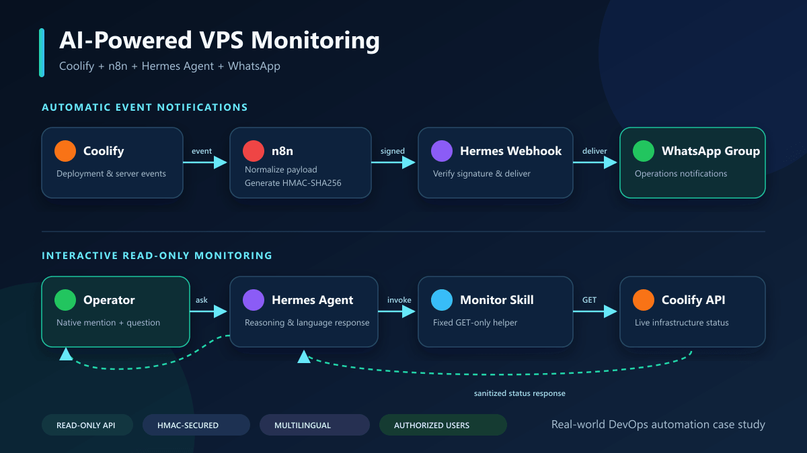

# Hermes + Coolify WhatsApp Assistant

**A secure, read-only AI operations assistant that delivers Coolify events to WhatsApp and answers natural-language questions about server, application, and deployment status.**



<p align="center">
  <a href="docs/case-study.md">Case Study</a> ·
  <a href="docs/architecture.md">Architecture</a> ·
  <a href="docs/installation.md">Installation</a> ·
  <a href="docs/operations-guide.md">Operations</a> ·
  <a href="docs/troubleshooting.md">Troubleshooting</a> ·
  <a href="docs/security.md">Security</a>
</p>

> **Project status:** the core monitoring, interactive query, and notification flows were validated in a real deployment. One additional WhatsApp sender/LID refresh remains a documented verification item.

## Project showcase

This project was shared publicly as a practical DevOps and AI automation case study:

- [LinkedIn project post](https://www.linkedin.com/posts/mahmud2640_devops-automation-aiagents-share-7517448961419448320-kYyS/)
- [Facebook project post](https://www.facebook.com/photo/?fbid=2232361427339925&set=a.958763984699682)

The social posts provide a short overview. This repository contains the complete architecture, implementation process, security decisions, encountered problems, root causes, solutions, and operational runbooks.

## Real-world case study

This repository documents an actual VPS automation journey rather than an idealized installation. It covers the original goal, architecture decisions, failed attempts, root causes, fixes, verification evidence, and final outcome.

- Read the complete [real-world case study](docs/case-study.md).
- Use the [operations guide](docs/operations-guide.md) after installation.
- Consult [troubleshooting](docs/troubleshooting.md) when a component behaves differently from the expected flow.

## What it solves

Small teams often discover deployment failures only after a user reports them. This project creates two operational paths:

1. **Push notifications** — Coolify events travel through n8n to a signed Hermes webhook and are delivered to a WhatsApp group.
2. **On-demand checks** — an authorized WhatsApp user asks a question, Hermes invokes a read-only skill, queries the Coolify API, and replies in the same conversation.

See the [architecture guide](docs/architecture.md) for sequence diagrams, trust boundaries, and design decisions.

## Features

- Deployment and infrastructure notifications in WhatsApp
- Natural-language server and application status checks
- Bengali, Banglish, and English conversations
- Dedicated bot number with sender allowlisting
- Group mention gating
- HMAC-verified webhook events
- Read-only Coolify API client
- Sanitized Docker Compose and environment templates
- Troubleshooting guidance for WhatsApp LIDs and stale bridges

## Validated outcomes

| Workflow | Result |
|---|---|
| Dedicated WhatsApp bot connection | Working |
| Mention-based WhatsApp group conversation | Working |
| Read-only Coolify API monitoring | Working |
| Natural-language infrastructure queries | Working |
| HTTPS Hermes webhook | Working |
| Coolify → n8n → Hermes → WhatsApp test notification | Working |
| Additional WhatsApp sender/LID | Configuration added; fresh bridge verification documented |

## Technology

- [Hermes Agent](https://hermes-agent.nousresearch.com/)
- [Coolify](https://coolify.io/)
- [n8n](https://n8n.io/)
- Docker Compose
- WhatsApp through Hermes' Baileys bridge
- Python standard library for the read-only Coolify client

## Repository layout

```text
.
|-- README.md
|-- LICENSE
|-- SECURITY.md
|-- .env.example
|-- .gitignore
|-- docker-compose.example.yml
|-- config/
|   `-- SOUL.example.md
|-- assets/
|   |-- hermes-coolify-architecture.png
|   `-- hermes-coolify-architecture.svg
|-- docs/
|   |-- architecture.md
|   |-- case-study.md
|   |-- installation.md
|   |-- n8n-workflow.md
|   |-- operations-guide.md
|   |-- security.md
|   `-- troubleshooting.md
|-- n8n/
|   `-- README.md
`-- skills/
    `-- coolify-monitor/
        |-- SKILL.md
        `-- scripts/
            `-- coolify_read.py
```

## Quick start

1. Start with the [real-world case study](docs/case-study.md) to understand why each component exists.
2. Read [the architecture](docs/architecture.md).
3. Follow [the installation guide](docs/installation.md).
4. Configure the [n8n notification flow](docs/n8n-workflow.md).
5. Validate and operate the system with the [operations guide](docs/operations-guide.md).
6. Review the [security checklist](docs/security.md).
7. Use [troubleshooting](docs/troubleshooting.md) if WhatsApp rejects an authorized user.

Copy the templates rather than editing them with real credentials committed to Git:

```bash
cp .env.example .env
cp docker-compose.example.yml docker-compose.yml
```

Populate `.env` in your deployment platform's secret manager. Do not commit it.

## Example commands

Run the sanitized read-only helper inside the Hermes container:

```bash
python /opt/data/skills/devops/coolify-monitor/scripts/coolify_read.py summary
python /opt/data/skills/devops/coolify-monitor/scripts/coolify_read.py applications
python /opt/data/skills/devops/coolify-monitor/scripts/coolify_read.py deployments
```

Example WhatsApp questions:

```text
@bot Are all servers healthy?
@bot আজকে কোনো deployment failed হয়েছে?
@bot testing branch-এর application status দেখাও
```

## Important limitations

- The Baileys integration emulates WhatsApp Web and is unofficial. Use a dedicated number; account restriction remains possible.
- A free LLM provider may be rate-limited, temporarily unavailable, or remove a model.
- `running:unknown` means no reliable health signal is available; it should not automatically be reported as a confirmed failure.
- WhatsApp may identify a sender by an opaque LID rather than their phone number. See [troubleshooting](docs/troubleshooting.md).
- This repository intentionally excludes write/deploy/restart operations from the Coolify skill.

## Publishing checklist

- [ ] Replace all screenshots with redacted versions
- [ ] Remove phone numbers, LIDs, public IPs, internal domains, tokens, QR codes, and session files
- [ ] Export a sanitized n8n workflow into `n8n/`
- [ ] Run a secret scan before the first push
- [ ] Add a short screen recording or GIF
- [x] Publish the project overview on LinkedIn
- [x] Publish the project overview on Facebook
- [x] Add the public social posts to this README

## Disclaimer

This is an independent integration example and is not affiliated with Meta, WhatsApp, Coolify, n8n, Nous Research, or Hermes Agent. Review the terms and security requirements of every connected service before production use.

## License

Released under the [MIT License](LICENSE).
