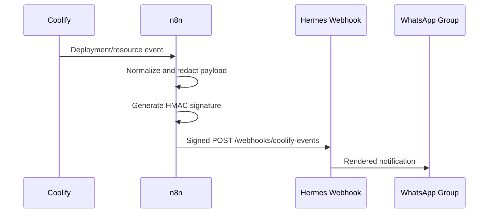
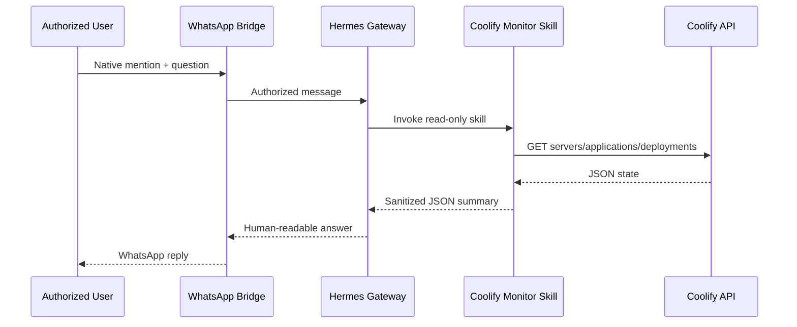

# Architecture

## Overview

The solution separates event delivery from interactive monitoring. Both paths end in WhatsApp, but only interactive questions invoke the language model and Coolify skill.

## Push notification path

Use Hermes `deliver-only` mode for deterministic notifications that do not need reasoning. It is faster and consumes no model tokens. Use an agent-backed route only when the event genuinely needs interpretation or enrichment.

## Interactive monitoring path

## Trust boundaries

| Boundary | Control |
|---|---|
| WhatsApp sender to Hermes | Explicit phone/LID allowlist and mention requirement |
| Internet to Hermes webhook | HTTPS and HMAC signature verification |
| Hermes to Coolify | Least-privilege bearer token and GET-only helper |
| Event payload to agent | Treat payload content as untrusted data |
| Repository to public GitHub | Placeholders, `.gitignore`, redacted media, secret scan |

## Design decisions

- **Dedicated WhatsApp number:** reduces the impact of an unofficial bridge restriction.
- **Read-only monitoring skill:** avoids accidental deployments or downtime.
- **n8n normalization:** prevents vendor-specific payload fields from leaking directly into notifications.
- **HMAC signatures:** detect altered or forged webhook requests.
- **Home channel delivery:** keeps scheduled and event-driven operational messages in one group.
