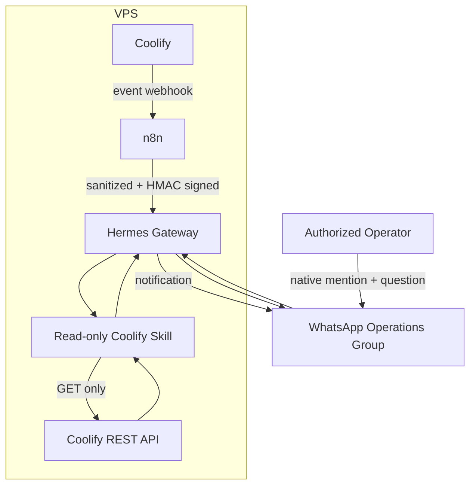

# Real-world case study

## Executive summary

The goal was to build a private AI operations assistant that could do two useful jobs from WhatsApp:

1. Automatically notify an operations group when something happens in Coolify.
2. Answer questions such as “Are all servers healthy?” or “Which deployment failed?” using live, read-only Coolify data.

The final design combines Coolify, n8n, Hermes Agent, a dedicated WhatsApp bot number, a custom read-only monitoring skill, and an HMAC-protected webhook. The project was not a one-click installation. Networking, WhatsApp identity, container state, free model availability, SSL, and configuration precedence all produced real operational problems. Each one is documented below so another user can understand both the solution and the reasoning behind it.

## The user story

> As the person responsible for several applications on a VPS, I want important deployment updates delivered to a WhatsApp group and I want to ask the assistant about current server/application health without opening the Coolify dashboard every time.

### Desired experience

```text
Operator: @bot এখন সব server ঠিক আছে?

Assistant: Sir, the Coolify host is reachable and usable.
Six applications are running normally. One application is exited/unhealthy.
No deployment is currently running.
```

For a deployment event:

```text
🔔 Coolify Notification

Event: deployment_success
Project: example-project
Branch: main
Status: Success ✅
Time: 18 Oct 2026, 12:17 AM
```

## Why this architecture was selected

### WhatsApp instead of a new dashboard

The operator already uses WhatsApp throughout the day. A conversational interface reduces the number of dashboards that must be opened for routine checks.

### Dedicated number instead of the personal number

Hermes' Baileys bridge emulates WhatsApp Web and is unofficial. A dedicated number limits the personal impact if WhatsApp restricts the account. This does not eliminate the risk.

### Read-only Coolify access

The assistant was designed to inspect infrastructure, not change it. Separating monitoring from deployment/restart actions reduces the chance that a prompt, malformed webhook, or model mistake causes downtime.

### n8n between Coolify and Hermes

n8n provides a visible workflow for normalizing events, formatting notifications, generating an HMAC signature, and controlling exactly what reaches Hermes.

## Final architecture



## Implementation journey

### Phase 1 — Choosing the WhatsApp integration

The first investigation considered Meta's official WhatsApp Cloud API. It is the stable production option, but it introduces business verification, template rules, and Cloud API setup. The desired experience was a private assistant in a normal WhatsApp group using a separate number, so the Hermes Baileys bridge was selected for this experiment.

**Decision:** use a dedicated number with the unofficial bridge, document the ban risk, and keep the official Cloud API as a future production migration.

### Phase 2 — Deploying Hermes in Coolify

Hermes was deployed as a Docker Compose service with persistent `/opt/data` storage. The volume is important because it preserves the WhatsApp session, agent configuration, skills, and other state across container recreation.

Core runtime configuration included:

- WhatsApp bot mode
- explicit sender allowlist
- group mention requirement
- webhook listener on port `8644`
- Coolify API base URL and token
- persistent Hermes data volume
- Docker host mapping for internal Coolify access

### Phase 3 — Pairing WhatsApp and creating the operations group

The dedicated number was linked through WhatsApp's **Linked devices** screen. The number was added to a private operations group and the group was registered as the Hermes home channel.

The system intentionally requires a native WhatsApp mention. Writing the characters `@bot` is not always enough because WhatsApp may not attach the required mention metadata. Selecting the bot from WhatsApp's mention picker is the reliable method.

### Phase 4 — Connecting Hermes to Coolify

Coolify API access was enabled and a team API token was created. From inside the container, Coolify was reached through the Docker host mapping rather than exposing an additional public service.

The API check returned HTTP `200`, confirming network connectivity and authentication. A custom skill then produced a sanitized summary containing server reachability, application status, branch information, healthcheck state, and running deployments.

### Phase 5 — Creating push notifications

Coolify notification events were sent to an n8n webhook. n8n normalized the payload, generated an HMAC-SHA256 signature, and forwarded the message to the public HTTPS Hermes webhook.

The webhook health endpoint returned:

```json
{"status":"ok","platform":"webhook"}
```

A Coolify test event successfully produced a WhatsApp notification. This validated the complete push path from Coolify to the group.

## Problems encountered and how they were solved

### 1. “Running (no healthcheck)” looked like a failure

**Symptom:** Coolify showed the Hermes service as running without a configured healthcheck.

**Root cause:** no healthcheck had been defined. This state means Coolify cannot make an additional health assertion; it does not mean the container is stopped.

**Attempted fix:** a healthcheck was added, but it targeted a listener that was not accepting the request at that moment. Coolify then reported the service as degraded/unhealthy even though the main process was running.

**Resolution:** remove the inaccurate healthcheck and keep the truthful `Running (no healthcheck)` state until a stable, version-compatible endpoint is selected.

**Lesson:** an incorrect healthcheck is worse than no healthcheck because it generates false incidents.

### 2. Healthcheck Compose schema validation failed

**Symptom:** deployment failed with an error similar to `services.healthcheck.timeout false schema`.

**Root cause:** the Compose healthcheck used an invalid boolean/value where a duration string was required.

**Resolution:** remove the healthcheck rather than keep an unverified configuration. If added later, use valid duration values such as `10s`, `5s`, and `30s`.

### 3. Container health request returned connection refused

**Symptom:** the Python health probe produced `Connection refused`.

**Root cause:** environment variables declared the webhook port, but the expected service was not yet listening on that address/port during the probe.

**Resolution:** inspect runtime variables and logs separately, then remove the misleading healthcheck. The webhook was later validated through its public HTTPS `/health` endpoint.

### 4. WhatsApp linked device became disconnected

**Symptom:** the bot stopped receiving messages after the linked device was removed or invalidated.

**Root cause:** Baileys relies on an active WhatsApp Web session stored in the persistent volume.

**Resolution:** run `hermes whatsapp` again, scan a new QR code, and verify `WhatsApp connected!` in the bridge log.

**Lesson:** pairing state and application configuration are different. A correct allowlist cannot compensate for an invalid WhatsApp session.

### 5. Group messages initially produced no reply

**Symptoms:** direct connectivity worked, but group messages did not trigger the bot.

**Causes investigated:**

- group not selected as the home channel
- mention requirement enabled
- plain text mention without WhatsApp mention metadata
- group policy and user allowlist

**Resolution:** register the operations group as the home channel, use a native mention, and keep authorized users in the allowlist.

### 6. Coolify API was disabled

**Symptom:** no API token could be used because instance-level API access was turned off.

**Resolution:** enable API access in Coolify settings, restrict source IPs, create a team API token, and verify the protected endpoint from inside the Hermes container.

### 7. Choosing the correct Docker-network address

**Symptom:** using the public URL or an incorrect local address complicated access from the Hermes container.

**Discovery:** the container had a private Docker address in the `172.16.0.0/12` range.

**Resolution:** add the Linux host-gateway mapping and use:

```yaml
extra_hosts:
  - host.docker.internal:host-gateway
```

Hermes could then reach the host Coolify service using `http://host.docker.internal:<port>` while the public dashboard remained separately controlled.

### 8. The custom Coolify skill did not exist after an attempted setup

**Symptom:** Hermes reported that the expected `SKILL.md` path did not exist.

**Root cause:** the file creation attempt was incomplete, and a shell heredoc remained open, showing a continuation prompt (`>`).

**Resolution:** exit the incomplete heredoc, create the complete skill directory and files under persistent `/opt/data`, then verify both the file path and the read-only helper directly.

**Verification:** the helper returned structured server and application data with no active deployments and without printing the API token.

### 9. Agent claimed it was checking but the model provider stalled

**Symptom:** WhatsApp showed repeated working/retry messages and the provider became temporarily unavailable.

**Root cause:** the selected free model/provider was rate-limited or temporarily unavailable. In another case, a previously free DeepSeek model returned HTTP `404` because the free route had been removed.

**Resolution:** stop the stuck request with `/stop`, select a currently available model, retry the request, and plan a fallback provider.

**Lesson:** model availability is a separate dependency. Monitoring connectivity can be healthy while the language model is unavailable.

### 10. Public Hermes webhook had an SSL problem

**Symptom:** the HTTPS webhook domain reported an SSL/certificate problem.

**Root cause:** DNS proxying and certificate provisioning were not aligned during initial setup.

**Resolution:** temporarily use DNS-only mode while Coolify/Traefik obtains and serves the certificate, verify DNS and HTTPS, and confirm the health response.

**Successful evidence:**

```json
{"status":"ok","platform":"webhook"}
```

### 11. HMAC-secured n8n delivery needed exact configuration

**Symptom:** the event path required a valid signature before Hermes would accept it.

**Resolution:** use n8n's Crypto/HMAC operation with SHA-256, sign the exact body sent to Hermes, store the shared secret outside the workflow export, and send the signature in the header expected by the Hermes route.

**Successful evidence:** the Coolify test notification arrived in WhatsApp with event, message, status, URL, and time.

### 12. A newly added user was still “Unauthorized”

**Symptom:** the new user's normal phone number was added, but Hermes logged:

```text
Unauthorized user: 123456789012345@lid (Example User) on whatsapp
```

**Root cause:** WhatsApp identified the participant with an opaque LID. The gateway compared the incoming LID with the phone-number allowlist.

**Resolution procedure:**

1. Add both the user's phone number and numeric LID, omitting `@lid`.
2. Redeploy/recreate the container, not only reload the Compose editor.
3. Compare the effective container variable with the bridge startup value.
4. If the bridge still shows the old list, terminate the stale bridge or update the saved Hermes allowlist and let the gateway spawn a fresh bridge.

```bash
printenv WHATSAPP_ALLOWED_USERS
grep "Allowed users:" /opt/data/whatsapp/bridge.log | tail -1
```

**Current evidence:** the container environment contains the new phone and LID, while the inspected bridge startup entry still showed the previous two users. The configuration change is therefore complete at the container level, but a fresh bridge startup showing all users is still required before claiming final success for the additional user.

**Lesson:** container environment, saved Hermes configuration, and the already-running Node bridge are three distinct states.

### 13. `link-preview-js` dependency warning appeared

**Symptom:** the bridge logged that `link-preview-js` could not be found while generating URL metadata.

**Assessment:** the same log ended with `WhatsApp connected!`. The warning affects URL preview generation and is not the reason an allowlisted user is rejected.

**Resolution approach:** keep authorization debugging separate. Repair dependencies only through a known-good Hermes image/update process so a redeploy does not erase an ad-hoc fix.

## Final validated outcome

| Capability | Result | Evidence |
|---|---|---|
| Hermes container | Successful | Container remained running in Coolify |
| Dedicated WhatsApp connection | Successful | Bridge logged `WhatsApp connected!` |
| Group conversation | Successful | Bot replied when natively mentioned |
| Home channel | Successful | Operations group accepted as the delivery target |
| Coolify API connectivity | Successful | Protected API request returned HTTP `200` |
| Read-only infrastructure summary | Successful | Server/application/deployment JSON returned |
| Natural-language monitoring | Successful | Hermes invoked the skill from WhatsApp |
| HTTPS webhook | Successful | `/health` returned webhook status `ok` |
| Coolify test notification | Successful | Formatted notification arrived in WhatsApp |
| New additional WhatsApp operator | Pending final bridge verification | Container has phone/LID; bridge must restart with the complete list |
| Automatic production event coverage | Ready for event-by-event validation | Test event passed; selected Coolify events should be enabled deliberately |

## What the final system can do

- Deliver deterministic Coolify notifications to the WhatsApp operations group.
- Answer live questions about server reachability, application status, branches, healthcheck state, and currently running deployments.
- Restrict use to explicitly authorized WhatsApp identities.
- Require group mentions to avoid responding to normal conversation.
- Preserve WhatsApp and Hermes state across redeployments through persistent storage.
- Keep the Coolify monitoring capability read-only.

## What the system deliberately cannot do

- It cannot deploy, restart, stop, or delete Coolify resources through the included skill.
- It cannot guarantee uninterrupted service from a free model provider.
- It cannot eliminate the account risk of an unofficial WhatsApp bridge.
- It should not label `running:unknown` as a confirmed failure.
- It should not expose infrastructure secrets or full private payloads in WhatsApp.

## Key lessons

1. Diagnose the pipeline layer by layer: WhatsApp, gateway authorization, model provider, skill, API, and notification path.
2. Verify effective runtime state instead of trusting only the Compose editor.
3. Keep identity aliases such as phone numbers and WhatsApp LIDs in mind.
4. Separate monitoring from mutation.
5. Use deterministic delivery when AI reasoning adds no value.
6. Document failed attempts; they are often the most reusable part of an infrastructure project.
7. A truthful unknown state is better than a confident but false health claim.

## Future improvements

- Move to the official WhatsApp Business Cloud API for production stability.
- Add a paid or self-hosted fallback model for predictable availability.
- Add event deduplication and incident correlation in n8n.
- Store deployment notification IDs to prevent duplicate group messages.
- Add uptime metrics and a tested version-specific Hermes healthcheck.
- Include sanitized commit author/message details in deployment notifications.
- Add tests for the Coolify response normalizer.
- Add screenshots and a short redacted demo recording to this repository.
